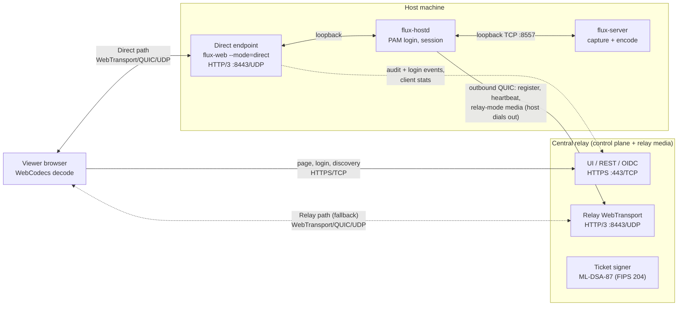
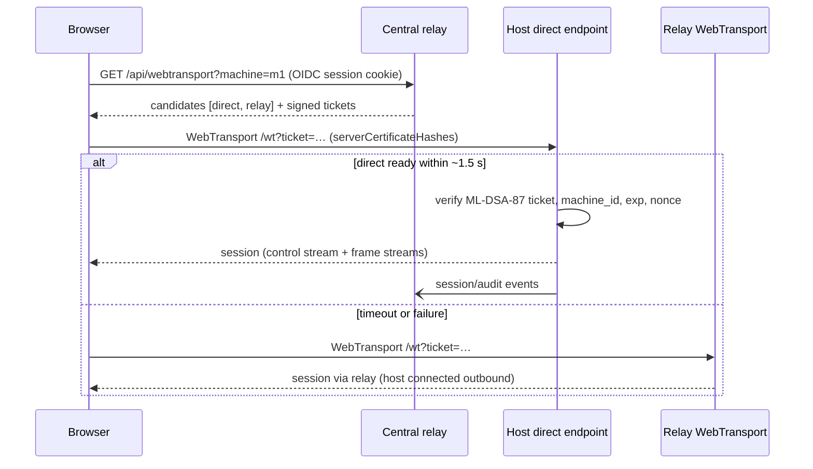

# Design: Relay and Direct connection modes

Status: **proposal** — nothing here is implemented yet. Current behaviour is documented in [../transport.md](../transport.md).

## Goal

Support two media paths for a viewer session, on a LAN or across the internet (WAN):

- **Relay mode** (today): browser ⇄ central relay ⇄ host.
- **Direct mode** (new): browser ⇄ host, with no relay hop for media.

The central relay remains the control plane in both modes: machine list, OIDC login, authorization, tickets, audit, and metrics. Only the media/control *path* differs.

## When each mode applies

| Network situation | Path | Why |
| --- | --- | --- |
| Browser and host on the same LAN | Direct | Avoids hair-pinning through a relay; lowest latency; no relay bandwidth. |
| WAN, host reachable (public IP, port forward, WireGuard/Tailscale/VPN) | Direct | Same as LAN once UDP reaches the host. |
| WAN, host behind NAT/firewall | Relay | Browsers cannot hole-punch with WebTransport (there is no ICE/STUN as in WebRTC), so the relay is the only path that always works. Regional relays bound the extra RTT. |
| Isolated LAN with no central relay | Standalone direct (optional, phase 3) | Host serves its own UI and login. |

The browser picks the path at connect time: **try direct, fall back to relay**.

## Target topology



## Components

### 1. Host dials out to the relay (relay mode over WAN)

Today the relay dials the host (`machineUpstream.connectQUIC` in `flux-web/upstream.go` → `flux-hostd` on UDP `:8556`). Over the internet that requires an inbound UDP port on every host, which NAT'd hosts don't have.

Change: `flux-hostd` opens an **outbound** QUIC connection to the relay (ALPN `flux-frames`, relay certificate verified normally via the system/CA trust store) and authenticates with `FLUX_RELAY_TOKEN` (later: a per-host credential). Once connected, the stream layout is unchanged — the relay still opens the bidirectional command stream and the host still sends one unidirectional stream per frame — so `upstream.go`'s frame/command handling is reused; only who dials changes. Registration and heartbeat can ride the same connection instead of separate HTTP POSTs.

Relay-initiated dialing stays available for hosts on the same network as the relay (and as the pod default) behind a config switch.

### 2. Direct endpoint on the host

Run the existing relay binary on each host in a single-machine mode (`FLUX_MODE=direct`):

- One static machine (already supported: `registry.seedStatic("default", …, FLUX_SERVER_ADDR)`), upstream over loopback to `flux-hostd`.
- No `/api/machines/register` from remote hosts; no machine list.
- Reuses as-is: WebTransport server, ABR/BWE (`abr.go`, `bwe.go`), login state machine (`login.go`), clipboard policy, Prometheus metrics.
- Does **not** serve the UI or do OIDC in hybrid deployments — it only accepts `/wt` sessions carrying a ticket signed by the central relay (component 3).

Why reuse the Go relay instead of WebTransport in Rust: the rate control, login, and clipboard logic would otherwise exist in two languages. The extra process costs only a loopback hop (well under 1 ms). A native Rust endpoint remains a later option if a single host binary becomes a requirement.

Packaging: a systemd unit next to `flux-hostd` on Linux, a service on Windows (Go cross-compiles; on Windows the upstream is standalone `flux-server`'s frame port instead of hostd).

### 3. Signed tickets

Today `/api/webtransport` returns a 60 s single-use ticket that only the issuing relay can verify (`wtTicketTTL` in `flux-web/auth.go`). Direct endpoints need tickets they can verify without calling back:

- The central relay signs a ticket with an **ML-DSA-87** key (FIPS 204, Go `crypto/mldsa`): `{machine_id, oidc_sub, preferred_username, is_admin, path: "direct", exp: now+60s, nonce}`. See [Cryptography](#cryptography-cnsa-20-fips-approved-post-quantum).
- Hosts receive the relay's public key at enrollment/registration and verify signature, `machine_id`, and `exp` locally; they keep a short nonce cache for single use.
- No shared secret leaves the relay; a compromised host can't mint tickets for other hosts.

The direct endpoint forwards login results, clipboard audit rows, and session start/end to the central relay (over the host's outbound connection) so audit stays centralized. If the relay is unreachable, events queue locally with a bounded buffer.

### 4. Discovery and fallback

`GET /api/webtransport?machine=…` returns ordered candidates:

```json
{
  "candidates": [
    {"path": "direct", "url": "https://192.168.1.20:8443/wt", "certHashes": ["…"], "ticket": "<signed>"},
    {"path": "relay",  "url": "https://relay.example.com:8443/wt", "certHashes": [],    "ticket": "<relay ticket>"}
  ]
}
```

- Direct candidates come from the host's heartbeat (its reachable addresses + current certificate hash). Admin policy per machine: `auto` (default), `direct-only`, `relay-only`.
- The browser tries the first candidate with a short timeout (≈1.5 s to `WebTransport.ready`), then the next. Later reconnects reuse the last path that worked, and retry direct in the background.
- The UI shows the active path, and client stats gain a `path` label (`direct`/`relay`) so metrics separate the two.



### 5. Certificates

WebTransport requires a secure page context. In hybrid deployments:

- The page is served by the central relay over normally trusted HTTPS.
- The direct endpoint uses a short-lived self-signed ECDSA P-256 certificate (the same scheme the relay already uses: 13-day lifetime, 6-day rotation in `flux-web/certificate.go`). The host reports the current hash in its heartbeat, and the browser pins it via `serverCertificateHashes`. **Hosts need no publicly trusted certificate.**

For standalone direct mode (phase 3), the host serves the page itself, so it needs a browser-trusted certificate: mkcert for development, an internal CA, or ACME when the host has a DNS name.

## Cryptography: CNSA 2.0 (FIPS-approved, post-quantum)

Requirement: FIPS-approved algorithms at CNSA 2.0 strength (ML-KEM-1024, ML-DSA-87, AES-256, SHA-384) on every leg, including the browser.

| Use | Algorithm | Standard | Notes |
| --- | --- | --- | --- |
| Ticket signatures (relay → direct endpoint) | ML-DSA-87 | FIPS 204 | Go `crypto/mldsa`. Signature 4,627 B, public key 2,592 B; ticket ≈ 6.4 KB base64url. |
| Host ↔ relay QUIC key exchange | ML-KEM-1024 (`MLKEM1024`, codepoint 0x0202) | FIPS 203 | Go `crypto/tls` `tls.MLKEM1024`; rustls `aws-lc-rs` provider `kx_group::MLKEM1024`. Pin as the only group on this leg. (rustls has no `SecP384r1MLKEM1024`, so the hybrid isn't an option here.) |
| Browser ↔ relay / direct endpoint key exchange | ML-KEM-1024 (0x0202) | FIPS 203 | Firefox 154+ supports it (`security.tls.enable_mlkem1024`, or enterprise policy `CNSA2KeyAgreementEnabled`), for both TLS and HTTP/3. It isn't on by default, and Firefox ESR doesn't have it. |
| TLS certificates / handshake signatures | ECDSA P-384 (CNSA 1.0, transitional) | FIPS 186-5 | Browsers don't accept ML-DSA certificates yet. Move to ML-DSA-87 when they do. |
| TLS 1.3 cipher suite / hashes | `TLS_AES_256_GCM_SHA384`, SHA-384 | FIPS 197, SP 800-38D, FIPS 180-4 | No AES-128 or ChaCha20-Poly1305. |

### Browser negotiation behaviour

Firefox adds ML-KEM-1024 as the **last** supported group and never sends it as an initial key share. A server that requires it answers with a HelloRetryRequest, so CNSA 2.0 sessions take one extra round trip to set up (connection setup only; it doesn't affect frame latency). The relay and direct endpoints therefore set `CurvePreferences = [MLKEM1024]` in `cnsa2` mode.

Per-deployment policy `FLUX_TLS_POLICY`:

- `cnsa2`: only `MLKEM1024`. Browsers without it (Firefox ESR, Firefox with the pref off, and any browser that doesn't offer 0x0202) fail the handshake, and the UI shows a "browser does not support CNSA 2.0" error page with the pref/policy name.
- `pq` (default): prefer `MLKEM1024`, then `SecP384r1MLKEM1024`, `SecP256r1MLKEM768`, `X25519MLKEM768`. No classical-only groups.

The negotiated group is recorded per session (relay log + a `tls_group` label on a low-cardinality client info metric), so non-CNSA sessions are visible.

### Implementation consequences

- **Go relay / direct endpoint:** build with the Go FIPS 140-3 module (`GOFIPS140=…`, `GODEBUG=fips140=on`); `crypto/mldsa` needs module v1.26.0 or later. In Go 1.27 the FIPS-mode default groups include `SecP384r1MLKEM1024` and `MLKEM1024`. quic-go uses `crypto/tls`, so `CurvePreferences` applies to QUIC/WebTransport too.
- **Go TLS 1.3 cipher suites aren't configurable** (`tls.Config.CipherSuites` only affects TLS 1.0–1.2), so Go can't be told to refuse AES-128. This must be resolved before claiming CNSA 2.0 compliance, either by confirming the FIPS-mode server picks AES-256 when the client offers it, or by patching/wrapping the suite selection.
- **Rust host:** switch rustls from `ring` (no ML-KEM, not FIPS-validated) to `aws-lc-rs` with the `fips` feature, restricted to `MLKEM1024` and `TLS13_AES_256_GCM_SHA384`. This affects `flux-hostd` (QUIC to the relay), `flux-server`, and registration (`reqwest`).
- **Certificates:** the relay's rotating self-signed certificate (`flux-web/certificate.go`, currently ECDSA P-256) and the direct endpoint's certificate move to ECDSA P-384 with ≤ 14-day validity. Whether browsers accept P-384 certificates for `serverCertificateHashes` still needs verifying; if they don't, CNSA deployments use CA-issued P-384 certificates (internal CA) instead of hash pinning.
- **Fleet setup:** managed Firefox fleets enable `CNSA2KeyAgreementEnabled` through enterprise policy. The deployment docs need a supported-browser matrix (Firefox 154+ with the policy; ESR excluded).

## Security considerations

- Direct endpoints listen on UDP `:8443` on the host; they accept only valid signed tickets and serve nothing else.
- Hosts never accept plaintext frame traffic from non-loopback peers (unchanged `FLUX_FRAME_ALLOW_PLAINTEXT` rule).
- PAM login on the host still gates the desktop in every mode.
- Revocation: tickets live 60 s; disabling a machine or user at the relay stops new tickets, and the relay can push a "disconnect session" message over the host's outbound connection.

## Phased plan (one PR each)

1. **Host dial-out** — outbound QUIC from `flux-hostd` to the relay, relay accepts host-initiated connections; keep relay-initiated dialing as an option. Unblocks relay mode for NAT'd hosts.
2. **Direct endpoint + signed tickets + discovery/fallback** — `FLUX_MODE=direct`, ML-DSA-87 tickets, ML-KEM-1024 key exchange on every leg (`FLUX_TLS_POLICY`), heartbeat-reported direct addresses and cert hash, candidate list, browser fallback, `path` metric label, per-machine path policy.
3. **Standalone direct (optional)** — direct endpoint serves its own UI with local auth for isolated LANs.

## Open questions

- Per-host credentials instead of the shared `FLUX_RELAY_TOKEN` for host dial-out (enrollment tokens, mTLS)?
- Which addresses should a host advertise for direct mode — all interfaces, an admin-configured list, or only RFC 1918 + configured public address?
- Should standalone direct (phase 3) use OIDC, or only host PAM login?
- Windows hosts: ship the direct endpoint as a separate service, or embed it in `flux-server`?
- Should `cnsa2` be the default `FLUX_TLS_POLICY`, or opt-in per deployment?
- Which browsers besides Firefox 154+ offer ML-KEM-1024 (0x0202)? (Not yet checked for Chrome, Edge, or Safari.)
