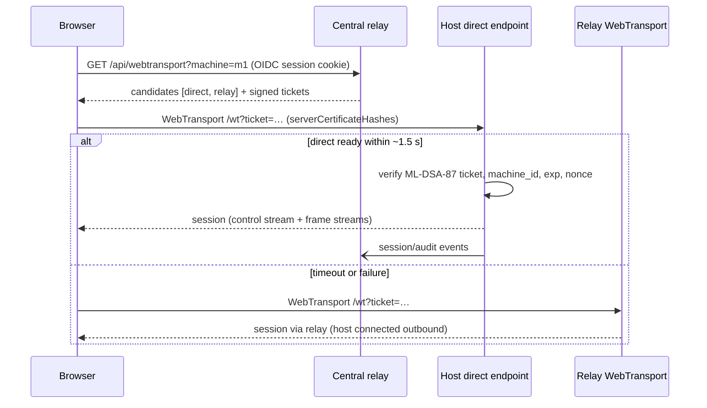

# Design: Relay and Direct connection modes

Status: **phase 2a implemented**; phase 2b is in progress, with the Rust aws-lc-rs/ML-KEM provider implemented. Standalone direct remains planned. Current behaviour is documented in [../transport.md](../transport.md).

## Goal

Support two media paths for a viewer session, on a LAN or across the internet (WAN):

- **Relay mode** (today): browser ⇄ central relay ⇄ host.
- **Direct mode** (new): browser ⇄ host, with no relay hop for media.

The central relay remains the control plane in both modes: machine list, OIDC login, authorization, ticket issuance, and metrics. Direct-mode login and clipboard audit are stored locally until phase 2b forwards them centrally.

## When each mode applies

| Network situation | Path | Why |
| --- | --- | --- |
| Browser and host on the same LAN | Direct | Avoids hair-pinning through a relay; lowest latency; no relay bandwidth. |
| WAN, host reachable (public IP, port forward, WireGuard/Tailscale/VPN) | Direct | Same as LAN once UDP reaches the host. |
| WAN, host behind NAT/firewall | Relay | Browsers cannot hole-punch with WebTransport (there is no ICE/STUN as in WebRTC), so the relay is the only path that always works. Regional relays bound the extra RTT. |
| Isolated LAN with no central relay | Standalone direct (optional, phase 3) | Host serves its own UI and login. |

The browser picks the path at connect time: **try direct, fall back to relay**.

## Target topology


## Components

### 1. Host dials out to the relay (relay mode over WAN)

Today the relay dials the host (`machineUpstream.connectQUIC` in `flux-web/upstream.go` → `flux-hostd` on UDP `:8556`). Over the internet that requires an inbound UDP port on every host, which NAT'd hosts don't have.

Change: `flux-hostd` opens an **outbound** QUIC connection to the relay (ALPN `flux-frames`, relay certificate verified normally via the system/CA trust store) and authenticates with `FLUX_RELAY_TOKEN` (later: a per-host credential). Once connected, the stream layout is unchanged — the relay still opens the bidirectional command stream and the host still sends one unidirectional stream per frame — so `upstream.go`'s frame/command handling is reused; only who dials changes. Registration and heartbeat can ride the same connection instead of separate HTTP POSTs.

Relay-initiated dialing stays available for hosts on the same network as the relay (and as the pod default) behind a config switch.

### 2. Direct endpoint on the host

Run the existing relay binary on each host in a single-machine mode (`FLUX_MODE=direct`):

- One static machine (already supported: `registry.seedStatic("default", …, FLUX_SERVER_ADDR)`), upstream over loopback to `flux-hostd`.
- No `/api/machines/register` from remote hosts; no machine list.
- Reuses as-is: WebTransport server, ABR/BWE (`abr.go`, `bwe.go`), login state machine (`login.go`), clipboard policy, Prometheus metrics.
- Does **not** serve the UI or do OIDC in hybrid deployments — it only accepts `/wt` sessions carrying a ticket signed by the central relay (component 3).

Why reuse the Go relay instead of WebTransport in Rust: the rate control, login, and clipboard logic would otherwise exist in two languages. The extra process costs only a loopback hop (well under 1 ms). A native Rust endpoint remains a later option if a single host binary becomes a requirement.

Packaging: the Linux host image builds `flux-web` without the UI and enables `flux-direct.service` after `flux-hostd`. Its wrapper exits successfully when `FLUX_DIRECT_ADDRS` is unset; otherwise it runs the endpoint with a separate `/var/lib/flux-direct` data directory and loopback upstream to hostd. The pod shares a network namespace with the relay, so it sets `FLUX_DIRECT_PORT=8445` to avoid relay UDP :8443; the wrapper uses that port for its default `FLUX_WT_ADDR`. The listener remains configurable and defaults to :8443 outside this pod setup.

### 3. Signed tickets

Today `/api/webtransport` returns a 60 s single-use ticket that only the issuing relay can verify (`wtTicketTTL` in `flux-web/auth.go`). Direct endpoints need tickets they can verify without calling back:

- The central relay signs a 60-second ticket with an **ML-DSA-87** key (FIPS 204, Go `crypto/mldsa`): `{machine_id, sub, username, email, name, admin, clipboard, path: "direct", exp, nonce}`. The 32-byte signing seed is stored at `$FLUX_DATA_DIR/ticket-mldsa87.seed` with mode `0600`. See [Cryptography](#cryptography-fips-approved-algorithms-by-default).
- A direct endpoint loads `FLUX_TICKET_PUBLIC_KEY` when pinned, otherwise fetches `GET /api/relay/ticket-key` with `FLUX_RELAY_TOKEN` and caches the key under `$FLUX_DATA_DIR/ticket-key.pub`. It refuses non-HTTPS relay URLs except HTTP loopback. Cached keys permit startup during relay outages. The active key refreshes every five minutes and asynchronously after a signature failure, throttled to once per 30 seconds; failed refreshes preserve the active key. Pinning disables all refresh.
- Ticket verification checks signature, version, path, machine ID, expiry, and single-use nonce. The nonce cache survives public-key replacement. The signed `clipboard` mode is enforced by the direct session; missing policy fails closed as `off`.
- No shared secret leaves the relay; a compromised host can't mint tickets for other hosts.

Login and clipboard audit remain in the direct endpoint's local SQLite store for now. Forwarding audit and login events to the central relay is phase 2b.

### 4. Discovery and fallback

`GET /api/webtransport?machine=…` returns ordered candidates:

```json
{
  "candidates": [
    {"path": "direct", "url": "https://192.168.1.20:8445/wt", "certHashes": ["…"], "ticket": "<signed>"},
    {"path": "relay",  "url": "https://relay.example.com:8443/wt", "certHashes": [],    "ticket": "<relay ticket>"}
  ]
}
```

- Direct addresses are admin-configured with `FLUX_DIRECT_ADDRS` (comma-separated); the host reports these candidates and the direct endpoint's certificate hashes in registration and heartbeat updates. In the pod, the direct endpoint is published on UDP :8445.
- Self-signed certificates are pre-generated before activation, live for 13 days, and rotate every six days. For the ten minutes before rotation, the relay and direct endpoint advertise `[current, next]` hashes, then advertise the new active hash first. Hostd's heartbeat interval is five seconds, so the ten-minute overlap exceeds twice that interval. The 13-day certificate lifetime remains within the browser's 14-day certificate-hash pinning limit.
- The browser tries the first candidate with a 1.5 s direct setup timeout; on failure it closes that transport and tries the next candidate. Relay gets 10 s. It records `directFailedAt` per machine in `sessionStorage` only after a direct attempt fails and prefers relay first for five minutes; relay success does not renew the timestamp, and direct success clears it. `path` is reported in client stats.
- The UI shows the active path, and client stats gain a `path` label (`direct`/`relay`) so metrics separate the two.



### 5. Certificates

WebTransport requires a secure page context. In hybrid deployments:

- The page is served by the central relay over normally trusted HTTPS.
- The direct endpoint uses a short-lived self-signed ECDSA P-256 certificate (the same scheme the relay already uses: 13-day lifetime, 6-day rotation in `flux-web/certificate.go`). The host reports the current hash in its heartbeat, and the browser pins it via `serverCertificateHashes`. **Hosts need no publicly trusted certificate.**
- The relay's rotating self-signed WebTransport certificate is not trusted by the host for host dial-out; configure `FLUX_TLS_CERT`/`FLUX_TLS_KEY` from a CA the host trusts, or provide that CA through `FLUX_RELAY_CA_FILE`.

For standalone direct mode (phase 3), the host serves the page itself, so it needs a browser-trusted certificate: mkcert for development, an internal CA, or ACME when the host has a DNS name.

## Cryptography: FIPS-approved algorithms by default

Goal: **FIPS-compatible, not FIPS-validated.** By default every leg uses FIPS-approved algorithms, preferring post-quantum ones. Other algorithms are not locked out. There is no Go FIPS mode (`GODEBUG=fips140`), no FIPS-module build, and no NIST certification.

| Use | Default (FIPS-approved) | Standard | Notes |
| --- | --- | --- | --- |
| Ticket signatures (relay → direct endpoint) | ML-DSA-87 | FIPS 204 | Go `crypto/mldsa`. Signature 4,627 B, public key 2,592 B; ticket ≈ 6.4 KB base64url. |
| Host ↔ relay QUIC key exchange | `MLKEM1024` (0x0202), `SECP256R1MLKEM768`, `X25519MLKEM768`, `SECP384R1`, `SECP256R1`, `X25519` | FIPS 203 (+ SP 800-56A for P-256/P-384) | rustls `aws-lc-rs` host preference, exactly in this order (`kx_group::*`); the classical X25519 fallback remains enabled. |
| Browser ↔ relay / direct endpoint key exchange | Server preference: `MLKEM1024`, `SecP384r1MLKEM1024`, `SecP256r1MLKEM768`, `X25519MLKEM768`, `CurveP256`, `CurveP384` | FIPS 203; SP 800-56A | The browser gets the first group it supports. Firefox 154+ can do `MLKEM1024` when `security.tls.enable_mlkem1024` / enterprise policy `CNSA2KeyAgreementEnabled` is on (it's sent last and only after a HelloRetryRequest, so it costs one extra setup round trip). Current browsers otherwise use `X25519MLKEM768`, whose ML-KEM component is approved. X25519 alone is left out of the server preference. |
| TLS certificates / handshake signatures | ECDSA P-256 (relay's rotating self-signed cert, as today) or P-384 | FIPS 186-5 | Browsers don't accept ML-DSA certificates yet. |
| Symmetric / hashes | AES-128/256-GCM, SHA-256/384 | FIPS 197, SP 800-38D, FIPS 180-4 | Prefer AES-GCM over ChaCha20-Poly1305 where the stack allows ordering. |

The negotiated TLS group is logged per session and exposed as a label on a low-cardinality client info metric, so non-PQ sessions are visible.

### Implementation consequences

- **Go relay / direct endpoint:** set `tls.Config.CurvePreferences` to the orders above (quic-go uses `crypto/tls`, so this covers QUIC and WebTransport). Go 1.27 implements every group listed. Go doesn't let you order TLS 1.3 cipher suites, and it already picks AES-GCM on hardware with AES acceleration.
- **Rust host — implemented:** `flux-crypto::crypto_provider()` shares rustls's `aws-lc-rs` provider (without the `fips` feature) across `flux-hostd`, `flux-server`, and registration (`reqwest`). Its host↔relay key-exchange order is `MLKEM1024`, `SECP256R1MLKEM768`, `X25519MLKEM768`, `SECP384R1`, `SECP256R1`, `X25519`; the provider retains its AES-GCM-first cipher-suite defaults.
- **Not required:** FIPS-validated modules, `GODEBUG=fips140=on`, or rejecting browsers that lack a given group.

## Security considerations

- Direct endpoints accept only valid signed tickets and serve nothing else. In the pod they listen on UDP `:8445`, separate from the relay's :8443 listener.
- Hosts never accept plaintext frame traffic from non-loopback peers (unchanged `FLUX_FRAME_ALLOW_PLAINTEXT` rule).
- PAM login on the host still gates the desktop in every mode.
- Revocation: tickets live 60 s; disabling a machine or user at the relay stops new tickets, and the relay can push a "disconnect session" message over the host's outbound connection.

## Phased plan (one PR each)

1. **Host dial-out — implemented.** `flux-hostd` opens an authenticated outbound QUIC link; the relay parks it and reuses the existing frame/command streams. Relay-dial mode remains the default.
   - Relay: `FLUX_HOST_LINK_ADDR` (default `:8444`, `off` disables); host: `FLUX_RELAY_QUIC_ADDR` and optional `FLUX_RELAY_CA_FILE`.
   - The relay's rotating self-signed WebTransport certificate is not trusted by the host; configure `FLUX_TLS_CERT`/`FLUX_TLS_KEY` from a CA trusted by the host, or supply the CA via `FLUX_RELAY_CA_FILE`.
2a. **Direct endpoint + signed tickets + discovery/fallback — implemented.** Includes the host-image `flux-direct.service`, ML-DSA-87 tickets with refresh/pinning, ticket-carried clipboard policy, PQ-preferred Go TLS groups, heartbeat-reported direct addresses and overlapping certificate hashes, browser fallback, and connection-path indicator.
2b. **Remaining direct-mode work.** Rust `aws-lc-rs`/ML-KEM is implemented. Add per-machine path policy, a `path` metric label, background direct retry, and audit forwarding to the central relay.
3. **Standalone direct (optional)** — direct endpoint serves its own UI with local auth for isolated LANs.

## Open questions

- Per-host credentials instead of the shared `FLUX_RELAY_TOKEN` for host dial-out (enrollment tokens, mTLS)?
- Should standalone direct (phase 3) use OIDC, or only host PAM login?
- Windows hosts: ship the direct endpoint as a separate service, or embed it in `flux-server`?
- Which browsers besides Firefox 154+ offer ML-KEM-1024 (0x0202)? (Not yet checked for Chrome, Edge, or Safari.)
