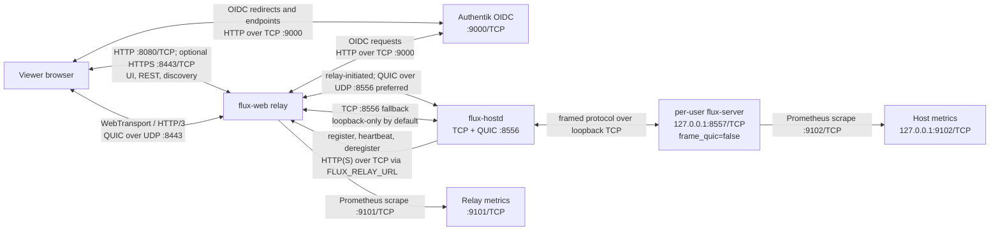
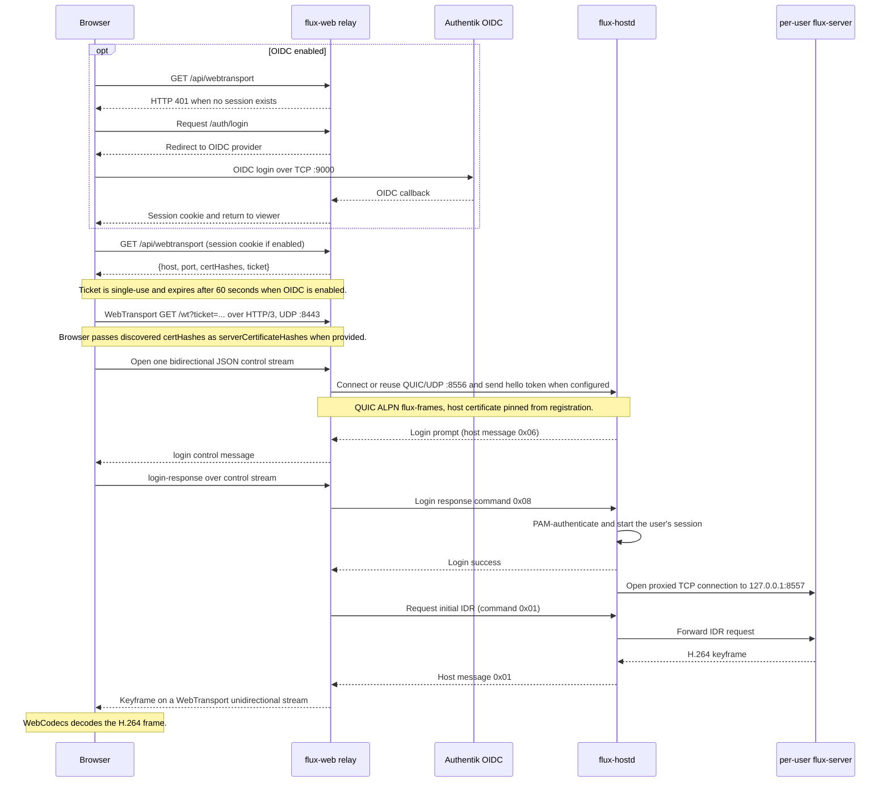
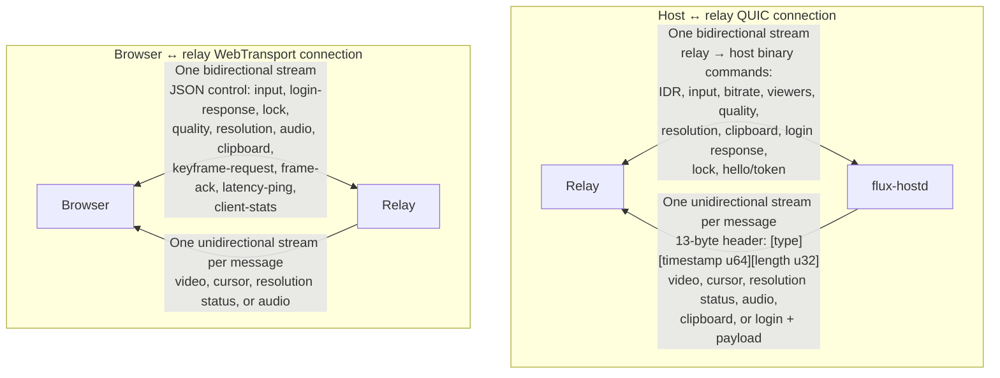
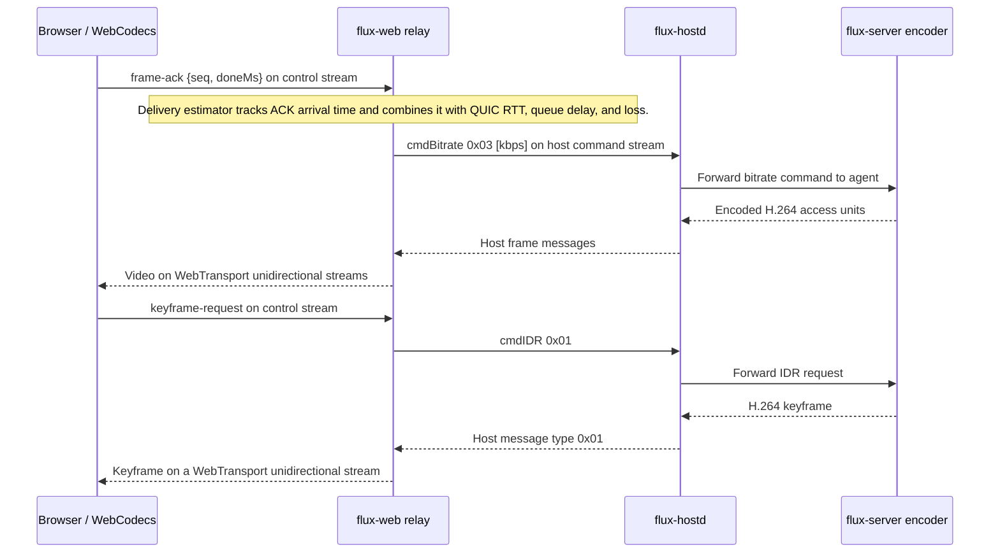

# Transport protocols

**Short answer:** the system uses both TCP and UDP, for different legs. HTTP(S) APIs and host registration use TCP; the relay prefers QUIC over UDP for the host frame link, with TCP fallback; browser media and control use WebTransport over HTTP/3/QUIC on UDP. Application messages use streams, not datagrams.

## Protocol and port map

| Leg | Transport | L4 | Port | Authentication | What it carries |
| --- | --- | --- | --- | --- | --- |
| Host registration → relay | HTTP(S) POST | TCP | `FLUX_RELAY_URL` (pod: `127.0.0.1:8080`) | Bearer `FLUX_RELAY_TOKEN` when configured | `POST /api/machines/register`, `/api/machines/:id/heartbeat`, and `/api/machines/:id/deregister`; host metadata, frame endpoint, login state, and QUIC certificate fingerprint. |
| Relay ↔ `flux-hostd` | QUIC preferred; TCP fallback | UDP and TCP | `FLUX_FRAME_PORT`, default `8556` (same port number) | QUIC uses ALPN `flux-frames` and the registered certificate SHA-256 pin; relay hello token when configured; host OS login is PAM-authenticated. Plaintext TCP accepts loopback peers unless `FLUX_FRAME_ALLOW_PLAINTEXT=true`. | Binary commands toward the host; H.264, cursor, resolution status, Opus, clipboard, and login messages toward the relay. |
| `flux-hostd` ↔ per-user `flux-server` | Framed byte stream | TCP | `127.0.0.1:8557` | Loopback-only agent; session is started after hostd's PAM login. | Hostd proxies agent frames and relay commands for the logged-in desktop. |
| Browser ↔ relay UI/API and discovery | HTTP; optional HTTPS | TCP | `:8080`; HTTPS defaults to `:8443` when relay TLS certificates are configured (`FLUX_HTTPS_ADDR`) | Relay OIDC session cookie when OIDC is enabled | UI, REST API, and `GET /api/webtransport`; HTTPS responses advertise `Alt-Svc: h3=":8443"`. |
| Browser ↔ relay media session | WebTransport over HTTP/3/QUIC | UDP | `:8443` | WebTransport TLS; browser pins discovered `certHashes` when the relay uses a self-signed certificate. With OIDC enabled, `/api/webtransport` issues a single-use, 60-second ticket for `/wt`. | One bidirectional JSON control stream and unidirectional video, cursor, resolution-status, and audio streams. DSCP is set to AF41. |
| Browser/relay ↔ Authentik OIDC | HTTP | TCP | `:9000` in the pod | OIDC | Browser login redirects and relay OIDC requests. |
| Prometheus scrape → relay | HTTP | TCP | `:9101` by default | Deployment/network policy | Relay metrics; pod publishes this port. |
| Prometheus scrape → standalone host agent | HTTP | TCP | `127.0.0.1:9102` by default | Loopback | Host metrics; not published by the pod. |

The pod publishes `8080/TCP`, `8443/TCP+UDP`, `9000/TCP`, and `9101/TCP`. Its containers share a network namespace: hostd's `8556` listener and the agent's `8557` listener are pod-internal. In the pod, the relay defaults to `127.0.0.1:8556`; the host advertises its frame endpoint using `FLUX_ADVERTISE_HOST`.

For the OS-login deployment, `flux-hostd` owns the relay-facing frame endpoint on `8556`; the per-user `flux-server` agent binds only to loopback on `8557`, with `frame_quic=false`. Without hostd, standalone `flux-server` can serve TCP and optional QUIC on the same frame port, controlled by `server.frame_quic`.

The HTTPS UI/API listener and the WebTransport HTTP/3 listener are separate: the web handler runs on the TCP listeners, while the HTTP/3 mux handles `/wt` on UDP. HTTPS responses advertise `Alt-Svc: h3=":8443"`. When relay TLS files are not configured, WebTransport uses a rotating self-signed certificate and `/api/webtransport` returns its hash; with configured TLS files, the relay uses those for HTTPS and WebTransport and does not return certificate hashes.

## Component flow

The relay initiates the host frame connection; arrows on that link show bidirectional application data. In QUIC mode hostd uses ALPN `flux-frames`, a persistent self-signed certificate at `/var/lib/flux/quic-cert.pem` (key at `/var/lib/flux/quic-key.pem`), a 15-second idle timeout, and a 3-second keepalive. The certificate SHA-256 is registered as `quic_cert_sha256` and pinned by the relay. In standalone server mode, stale P-frame streams can be reset so newer frames are not blocked behind them.

## Viewer connection sequence

The host frame endpoint can already be connected while the browser completes discovery; the relay reuses that upstream session when available.

## Stream layout

The relay-to-browser video stream carries kind, sequence, capture timestamp, keyframe flag, length, and H.264 data; metadata and Opus audio use their own stream kinds. The host-side frame header is `[type u8][timestamp u64 BE, in μs][length u32 BE][payload]`. TCP fallback carries the same framed host protocol as a sequential byte stream rather than separate QUIC streams.

The application currently sends its data on streams, not QUIC datagrams. The WebTransport server enables QUIC datagram capability, but no application datagram send/receive calls are used.

## Keyframe and bitrate feedback

## Source files

- Host listeners, relay registration, PAM login, and agent proxy: [`flux-hostd/main.rs`](../flux/crates/flux-hostd/src/main.rs), [`flux-hostd/quic.rs`](../flux/crates/flux-hostd/src/quic.rs), [`flux-hostd/proto.rs`](../flux/crates/flux-hostd/src/proto.rs), and [`flux-core/registration.rs`](../flux/crates/flux-core/src/registration.rs).
- Agent and standalone frame transport: [`flux-server/main.rs`](../flux/crates/flux-server/src/main.rs), [`flux-server/quic_frames.rs`](../flux/crates/flux-server/src/quic_frames.rs), [`flux-core/config.rs`](../flux/crates/flux-core/src/config.rs), and [`flux-gen-config`](../containers/host/rootfs/usr/local/bin/flux-gen-config).
- Relay upstream, frame/command kinds, discovery, HTTP/HTTPS, and WebTransport: [`upstream.go`](../flux-web/upstream.go), [`proto.go`](../flux-web/proto.go), [`main.go`](../flux-web/main.go), and [`webtransport.go`](../flux-web/webtransport.go).
- Relay tickets and WebTransport certificates: [`auth.go`](../flux-web/auth.go) and [`certificate.go`](../flux-web/certificate.go).
- Browser discovery, control streams, and media decoding: [`webtransport-client.ts`](../flux-web/ui/lib/webtransport-client.ts).
- Pod port mappings and host/relay environment: [`flux-pod.yaml`](../containers/flux-pod.yaml).
